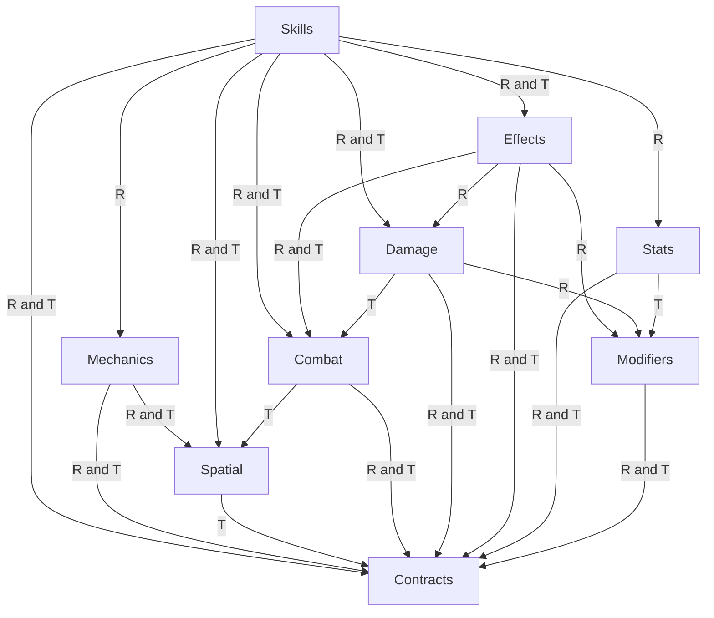

# v2.0.0 Architecture Boundary Audit

## Executive Summary

Status: READY for Developer review of this audit only. This is migration preparation, not a Kernel implementation or a release. Audited source: `498c3e1c118e6c5a33811941ee4eddc7f46c574f` from `origin/main`; branch `audit/v2.0.0-architecture-boundaries`. Audit date: 2026-10-18 (Asia/Bangkok). The direct user instruction to create a new branch overrides the attachment's keep-current-branch preflight. Initial working tree was clean on `feat/v1.2.0-healing-foundation@f99c7dca76bc8e8bf6d92a51d791183a0a77135c`.

The current library owns calculations **and** Skill execution, action admission, delivery simulation, effect lifecycle, triggers, resource writes and events. It satisfies its existing v1 architecture checker; these are **proposed v2 boundary violations**, not newly demonstrated v1 defects. A numeric-only Kernel can be extracted without replacing these runtimes, but moving entire folders would import gameplay through both runtime and type edges.

All **35 non-barrel canonical modules**, **10 barrels**, **27 deprecated source forwarders**, and **243 unique public symbols** were classified. The baseline inventories all ten package entrypoints (root plus nine domains), symbols, actual source dependencies and compatibility paths. API classifications: KERNEL 7, LEGACY 190, SPLIT 43, ADAPTER 3. Counts identify symbol ownership once; repeated exports across entrypoints are not separate implementations.

`npm ci --ignore-scripts` and the full `npm run verify` completed successfully: **458 tests in 35 files**, no runtime cycles, 10 reported combined/type-containing cycle paths, 27 preserved legacy modules, deterministic example and installed archive consumer. See [baseline](2.0.0-baseline.md) for actual command results and evidence limits. Only these three new documentation files are delivered. Historical provenance, source, package version 1.0.0, exports, formulas and checkers remain unchanged.

## Current Architecture

The current authority remains [ARCHITECTURE.md](../ARCHITECTURE.md). This report proposes a later architecture and does not supersede that document or authorize extraction. Applications already supply clock, RNG, entities, positions, config and advancement order. Headless/deterministic execution is still execution; absence of UI does not make a delivery runtime part of a calculation Kernel.

Source-derived graph (R = runtime or mixed import; T = exclusively type-only import; root and shared forwarder edges are enumerated in the baseline):

Domain adjacency (runtime includes mixed imports; type column lists exclusively type-only declarations, so a domain can appear in both):

| Source domain | Modules including barrel | Runtime/re-export targets outside domain | Type-only targets outside domain |
| --- | --- | --- | --- |
| combat | 3 | contracts | contracts, spatial |
| contracts | 12 | none | none |
| damage | 3 | contracts, modifiers | combat, contracts |
| effects | 4 | combat, contracts, damage, modifiers | combat, contracts |
| mechanics | 6 | contracts, spatial | contracts, spatial |
| modifiers | 2 | contracts | contracts |
| skills | 9 | combat, contracts, damage, effects, mechanics, spatial, stats | combat, contracts, damage, effects, spatial |
| spatial | 3 | none | contracts |
| stats | 2 | contracts | contracts, modifiers |

`src/index.ts` re-exports the nine domain barrels. Contracts carry indirect Gameplay reachability despite having no outward domain imports. All file-level edges, imported symbol lists, source line numbers, re-exports and current cycle paths appear in the [baseline dependency ledger](2.0.0-baseline.md#source-dependency-ledger).

## Ownership Matrix

KERNEL means numeric responsibility suitable for extraction, not proof that its current contracts are already generic. SPLIT marks mixed numeric and gameplay ownership. LEGACY keeps behavior outside Kernel (including optional-library candidates). ADAPTER maps legacy inputs/outputs onto canonical numbers; it must never recalculate independently. Module rows describe implementation, while the baseline classifies every public symbol separately. The final columns separate current evidence from future missing migration tests.

| Canonical source | Class / risk / complexity / proposed milestone | Actual ownership: calculation, state, execution, events | Future canonical owner / dependency cut | Existing evidence / missing migration evidence |
| --- | --- | --- | --- | --- |
| [src/combat/combat-entity.ts](../../src/combat/combat-entity.ts) | SPLIT / High risk / High complexity / v2.0.7 | applyEntityDamage/Healing/ManaGain return pure numeric transitions; entity validators enforce game identity/base-stat schema. No entity writes or callbacks here. | Kernel resource arithmetic; Legacy entity validators. Separate scalar transitions from ATTRIBUTE_IDS/STAT_IDS and entity contracts. | tests/combat/combat-entity.test.ts; tests/combat/healing.test.ts; tests/combat/mana-gain.test.ts. Missing: Preserve asymmetry: damage tolerates HP above max; healing/MP reject it. |
| [src/combat/combat-state.ts](../../src/combat/combat-state.ts) | LEGACY / High risk / High complexity / v2.0.8 | Liveness/relations/target/restriction/action admission; start/complete/cancel mutate caller slots and push events; combatActionPhase is pure action timing. | Legacy Combat / Game Rules. combatActionPhase purity does not justify action contracts in Kernel; sanitizeActionSlot remains internal Legacy. | tests/skills/skill-execution.test.ts; tests/integration/status-restrictions.test.ts. Missing: Event order, serial, cancellation and epsilon parity after import rewiring. |
| [src/contracts/combat-entity.ts](../../src/contracts/combat-entity.ts) | LEGACY / High risk / Medium complexity / v2.0.8 | Entity identity, player/monster kinds, factions, tags and mutable HP/MP view; data only, no writes/events. | Legacy entity contracts. CharacterBaseStats transitively imports config/damage/targeting; Kernel must accept resolved scalar data, not CombatEntity. | tests/combat/combat-entity.test.ts. Missing: Kernel contracts need a compile fixture without entity dependencies. |
| [src/contracts/combat-modifiers.ts](../../src/contracts/combat-modifiers.ts) | SPLIT / High risk / Medium complexity / v2.0.3 | Operation arithmetic vocabulary plus closed source/tag/target schema and validation; no lifecycle mutation. | Kernel numeric operation inputs; Legacy source and predicate adapter. Separate numerical operations from setting/equipment/buff/passive and known-stat validation. | tests/modifiers/modifier-core.test.ts; tests/effects/effect-modifiers.test.ts. Missing: Kernel arbitrary-key validation and Legacy rejection parity. |
| [src/contracts/combat-state.ts](../../src/contracts/combat-state.ts) | LEGACY / High risk / Medium complexity / v2.0.8 | Action, target, relation, restriction and event unions; types include mutable slots and lookup callbacks. | Legacy / Game Rules contracts. CombatEntity and MapPoint must never enter Kernel declarations. | tests/skills/skill-execution.test.ts; tests/integration/status-restrictions.test.ts. Missing: Consumer exhaustive unions and declaration parity after isolation. |
| [src/contracts/damage-contracts.ts](../../src/contracts/damage-contracts.ts) | SPLIT / Critical risk / High complexity / v2.0.5 | B0 coefficients/settings mixed with SkillMechanics, combat identities, delivery and closed damage vocabulary. | Kernel resolved coefficient inputs; Legacy damage-context adapter. DamageDefinition.mechanics, DamageContext.entities/defender.mechanic, DamageSettings.skills and setting/item policies. | tests/damage/damage-core.test.ts; tests/integration/root-offense.test.ts. Missing: No-Skills/no-Mechanics Kernel declaration graph; exact diagnostic result mapping. |
| [src/contracts/defense-settings.ts](../../src/contracts/defense-settings.ts) | SPLIT / High risk / Medium complexity / v2.0.6 | Rating coefficients and bounds mixed with Physical/Magic and DamageDelivery-specific dodge eligibility. | Kernel rating/hit inputs; Legacy defense policy adapter. Replace delivery discriminant at Kernel boundary with resolved dodge eligibility and selected rule. | tests/damage/defense-engine.test.ts. Missing: Disabled/missing-config result and RNG call-count parity. |
| [src/contracts/dot-contracts.ts](../../src/contracts/dot-contracts.ts) | LEGACY / High risk / Medium complexity / v2.0.9 | Poison/Burning/Bleeding on-hit FIFO timed stack config/defaults and exact validators. | Legacy DoT contracts. DAMAGE_TAGS validation is Gameplay vocabulary, not a generic tick formula. | tests/integration/skill-effect-integration.test.ts. Missing: Keep existing DoT regressions; attribution remains unresolved. |
| [src/contracts/effects.ts](../../src/contracts/effects.ts) | LEGACY / High risk / Medium complexity / v2.0.9 | Effect definitions, active instances, application/terminal outcomes and buff-source mapping. | Optional Buff Runtime candidate; retained Legacy initially. CombatEntity, CombatRestriction, relations and source identity belong outside Kernel. | tests/effects/effect-system.test.ts; tests/effects/effect-lifecycle.test.ts. Missing: Independent-library packaging/admission contract requires later review. |
| [src/contracts/mechanic-contracts.ts](../../src/contracts/mechanic-contracts.ts) | LEGACY / High risk / Medium complexity / v2.0.9 | Closed projectile/melee/AoE/emitter/DoT specifications and cast validators; no execution itself. | Legacy delivery / optional geometry contracts. Depends on DoT validator; not a calculation primitive simply because dimensions are numeric. | tests/skills/skill-engine.test.ts; tests/integration/skill-effect-integration.test.ts. Missing: No Kernel exports of delivery schemas. |
| [src/contracts/spatial.ts](../../src/contracts/spatial.ts) | LEGACY / Low risk / Low complexity / v2.0.9 | MapPoint and bottom-left string-cell Walkability data; no calculation or mutation. | Legacy / optional Spatial. Keep coordinate/grid conventions outside numeric Kernel contracts. | tests/spatial/grid-geometry.test.ts. Missing: Optional library boundary test; no inferred need in Text RPG. |
| [src/contracts/stat-contracts.ts](../../src/contracts/stat-contracts.ts) | SPLIT / High risk / Medium complexity / v2.0.4 | Attribute/stat lists, scaling/bounds, bundled player defaults and config upgrades; upgrade clones input, defaults are initialized at module load. | Kernel numeric rule shapes; Legacy defaults/config adapter. PlayerStatsConfig imports DamageSettings, TargetingSettings, DefenseSettings and modifier policy. | tests/stats/stat-calculation.test.ts. Missing: Generic identifiers/config isolation plus exact default/upgrade compatibility. |
| [src/contracts/targeting-contracts.ts](../../src/contracts/targeting-contracts.ts) | LEGACY / Medium risk / Medium complexity / v2.0.8 | Faction and self/entity/ground targeting configuration and exact validator. | Legacy / Game Rules targeting. Combat-state and spatial types have no place in Kernel. | tests/combat/combat-entity.test.ts; tests/skills/skill-engine.test.ts. Missing: Legacy validators must retain accepted/rejected shapes. |
| [src/damage/damage-core.ts](../../src/damage/damage-core.ts) | SPLIT / Critical risk / High complexity / v2.0.5 | calculateDamage owns B0/B1, critical and defense call; snapshots clone/freeze offense; context adapter derives boss/elite and live defense. RNG callbacks are consumed; no entity writes/events. | Kernel numerical damage; Legacy context/snapshot facade. Combat identity import, entity labels, option-source rules, DamageDefinition.mechanics and damageBonusReason. | tests/damage/damage-core.test.ts; tests/integration/root-offense.test.ts; tests/integration/skill-effect-integration.test.ts. Missing: Side-by-side adapter parity without shipping a second calculator; nested breakdown and RNG trace. |
| [src/damage/defense-engine.ts](../../src/damage/defense-engine.ts) | SPLIT / High risk / High complexity / v2.0.6 | Rating reduction/mitigation and hit chance; validateDefenseContext and DoT dodge exclusion bind calculation to delivery. No resources/events; lazy RNG. | Kernel rating/hit arithmetic; Legacy delivery policy. DefenseContext.mechanic and closed Physical/Magic selection. | tests/damage/defense-engine.test.ts. Missing: Parity of omitted roll/null result/missing config and full result diagnostics. |
| [src/effects/dot-core.ts](../../src/effects/dot-core.ts) | LEGACY / High risk / High complexity / v2.0.9 | applyDotSnapshot mutates groups and filters frozen offense; tickDotRuntime decrements/consumes FIFO stacks, invokes callbacks; dotDamage aggregates canonical calculateDamage. | Legacy DoT adapter delegating Kernel damage. Do not extract dotDamage with DotGroup, timing, skill/source IDs or mechanic=dot into Kernel. | tests/integration/skill-effect-integration.test.ts; tests/integration/rpg-core-integration.test.ts. Missing: Retain DoT no-crit/no-dodge, expiry precedence and existing attribution limitation. |
| [src/effects/effect-lifecycle.ts](../../src/effects/effect-lifecycle.ts) | LEGACY / Critical risk / High complexity / v2.0.9 | Owns private active maps, serial frontiers, clock, expire/refresh/stack, restrictions, terminal disposal and weak consume plans; returns events, no modifier arithmetic. | Optional Buff Runtime candidate; Legacy facade. Combat admission/identity and buff-source vocabulary; preserve one store and receipt owner. | tests/effects/effect-lifecycle.test.ts; tests/effects/effect-stacking.test.ts; tests/effects/stack-consumption.test.ts. Missing: No duplicate lifecycle; exact-N atomic consume, same-boundary expiry and stale plan parity. |
| [src/effects/effect-system.ts](../../src/effects/effect-system.ts) | LEGACY / Medium risk / Medium complexity / v2.0.9 | Definition validation/freeze and instance/apply references; exact modifier/restriction/stack policies with Combat validation, no active store. | Optional Buff Runtime candidate / Legacy validation. Pure schema validation is still gameplay policy; numeric modifier evaluation already belongs to Modifiers. | tests/effects/effect-system.test.ts. Missing: Independent extraction would need explicit host admission ports. |
| [src/mechanics/aoe-sequence-core.ts](../../src/mechanics/aoe-sequence-core.ts) | LEGACY / High risk / High complexity / v2.0.9 | Internal random/sequencePosition/strikeAOE geometry and tickAOESequenceRuntime; seed and sequence timers mutate, onStrike callbacks execute. | Legacy sequence delivery. Pure random-area sampling is geometry, not Kernel; preserve caller boundary partition. | tests/integration/skill-effect-integration.test.ts. Missing: RNG order and coarse/fine boundaries; helper is not package-public. |
| [src/mechanics/emitter-core.ts](../../src/mechanics/emitter-core.ts) | LEGACY / Medium risk / Medium complexity / v2.0.9 | Internal emitterProjectileConfig constructs radial angles; tickEmitterRuntime mutates timers/object collection and calls emission. | Legacy emitter delivery. No stat formula here; radial pattern belongs to Gameplay. | tests/integration/skill-effect-integration.test.ts; tests/skills/nested-composition.test.ts. Missing: Actual-emission counts, single firing and teardown parity. |
| [src/mechanics/instant-aoe.ts](../../src/mechanics/instant-aoe.ts) | LEGACY / Medium risk / Medium complexity / v2.0.9 | Copies selected placement and delegates circle contact to melee, truncates maxTargets; internal debug. | Legacy AoE delivery. Origin/caster/target policy and LOS remain Gameplay; no Kernel extraction. | tests/integration/skill-effect-integration.test.ts. Missing: Placement timing and target truncation parity. |
| [src/mechanics/melee-hitbox.ts](../../src/mechanics/melee-hitbox.ts) | LEGACY / Medium risk / Medium complexity / v2.0.9 | Pure point/shape geometry with HP/identity/LOS selection; debug outline is internal. No damage math or persistent writes. | Legacy delivery / optional geometry. insideMeleeHitbox/hitboxFrame are geometry, not required RPG arithmetic; preserve input-order dedup. | tests/integration/skill-effect-integration.test.ts. Missing: Optional geometry package acceptance; no new Kernel dependency. |
| [src/mechanics/projectile.ts](../../src/mechanics/projectile.ts) | LEGACY / High risk / High complexity / v2.0.9 | segmentContact/directions are pure geometry; moveProjectile mutates body/contact history; chronological tick filters bullets and invokes hits; internal debug. | Legacy projectile delivery / optional geometry. Grid, hit policy, target HP, lifetime and contacts are Gameplay delivery. | tests/integration/skill-effect-integration.test.ts; tests/skills/nested-composition.test.ts. Missing: Preserve contact tie order, stop/pierce, walls, disposal and emission budgets. |
| [src/modifiers/modifier-core.ts](../../src/modifiers/modifier-core.ts) | SPLIT / High risk / High complexity / v2.0.3 | Canonical identity dedup/sort and flat-percent-points arithmetic; active source filtering and damageBonusReason are Legacy adapters. Prepared closure groups inputs; no persistent store/events. | Kernel aggregation; Legacy collection/predicates. Closed validator stat IDs and DamageContext must stay in Legacy before extraction. | tests/modifiers/modifier-core.test.ts; tests/effects/effect-modifiers.test.ts. Missing: Parity for conflict errors, source order, contribution identity and unknown keys. |
| [src/skills/root-offense.ts](../../src/skills/root-offense.ts) | SPLIT / Critical risk / High complexity / v2.0.8 | Calls Damage.snapshotActorOffense for immutable numbers; owns weak session/execution activation trust, root capture timing and component assembly; detached public copy. | Legacy trust adapter over Kernel-owned offense extraction. RootOffensiveSnapshot/SkillRootOffenseCapture/deriveSkillRootDamage remain Skills; only numeric input capture can delegate. | tests/integration/root-offense.test.ts; tests/skills/skill-instance.test.ts. Missing: Object identity, shared S0, clone isolation, timing and stale session rejection. |
| [src/skills/skill-effect-integration.ts](../../src/skills/skill-effect-integration.ts) | LEGACY / Critical risk / High complexity / v2.0.8 | Canonical ordered dispatcher and delivery runtime; contact validation, live HP/MP writes, recovery coupling, events, delayed children, effects/DoT and cleanup. | Legacy / Game Rules execution delegating numeric Kernel. Keep applyDamage/hit/heal/restoreMana/lifesteal/manaOnHit orchestration here; do not build a replacement engine. | tests/integration/skill-effect-integration.test.ts; tests/integration/recovery-acceptance.test.ts; tests/skills/nested-composition.test.ts. Missing: Whole event/resource/RNG traces across every delivery and nested composition after delegate. |
| [src/skills/skill-effects.ts](../../src/skills/skill-effects.ts) | LEGACY / High risk / High complexity / v2.0.8 | Closed ordered effect and component schemas; validates damage coefficients and tags plus delivery, recovery, modifier-effect and stack-consumption policies; freeze helper. | Legacy Skill definition adapter. SkillDamageComponent is Gameplay even though it carries numbers; future numeric adapter strips id/tags/rank policy. | tests/skills/skill-engine.test.ts; tests/integration/percent-recovery.test.ts. Missing: Unknown fields, limits and numeric/percent amount union parity. |
| [src/skills/skill-engine.ts](../../src/skills/skill-engine.ts) | LEGACY / High risk / High complexity / v2.0.8 | Defines/validates Skill; availability checks; startSkillAction subtracts live MP and commits deadline/action once; inheritance mutates cooldown maps. | Legacy / Game Rules Skill admission. Delegate cooldownDurationMs only; definitions, serials and cost decisions remain Legacy. | tests/skills/skill-engine.test.ts; tests/skills/skill-execution.test.ts. Missing: No mutation on rejection; successful cancellation keeps MP/deadline. |
| [src/skills/skill-execution.ts](../../src/skills/skill-execution.ts) | LEGACY / Critical risk / High complexity / v2.0.8 | Pins definition, target, positions and root offense before successful start; weak recovery identities, action activation/cancel/complete and event ordering. | Legacy / Game Rules execution. Keep range/spatial, trusted source pins, snapshot timing, cost commit and trigger registration together. | tests/skills/skill-execution.test.ts; tests/integration/root-offense.test.ts; tests/integration/recovery-acceptance.test.ts. Missing: 0/100% boundaries, replaced/dead entities, replay/disposal and registration parity. |
| [src/skills/skill-instance.ts](../../src/skills/skill-instance.ts) | LEGACY / Critical risk / High complexity / v2.0.8 | Weak runtime/execution handles and session records, immutable pins, Root/Child lifecycle, budget/replay checks, shared S0 and terminal payload removal. | Legacy Skill instance runtime. assembleRootDamage call delegates numbers; no instance/session authority in Kernel. | tests/skills/skill-instance.test.ts; tests/skills/nested-composition.test.ts. Missing: Receipt pin identity, terminal/lifetime and maxLiveChildren parity. |
| [src/skills/skill-trigger.ts](../../src/skills/skill-trigger.ts) | LEGACY / Critical risk / High complexity / v2.0.8 | Pins trusted DAGs; captures impact/expiry/hit/kill/stack edges, validates weak receipts, queues children and enforces depth/intents/queue/work/projectile budgets. | Legacy / Game Rules trigger dispatch. Pure DAG checks are Skill policy; all receipt/budget/session ownership stays outside Kernel. | tests/skills/skill-trigger.test.ts; tests/integration/conditional-triggers.test.ts; tests/integration/recovery-acceptance.test.ts. Missing: No bypass for fatal victim/self Child; exactly-once and reentrancy budget parity. |
| [src/skills/skill-upgrade.ts](../../src/skills/skill-upgrade.ts) | LEGACY / High risk / High complexity / v2.0.8 | Pure all-or-nothing trusted content transform, conflict detection and re-pinning of Skill bundles; no live casts/resources. | Game Rules authoring / Legacy compatibility. Pure definition resolution remains Gameplay; must not import Skill schemas into Kernel. | tests/integration/skill-upgrade.test.ts. Missing: Old pin immutability, stale revision, conflicting writes and cooldown inheritance parity. |
| [src/spatial/grid-geometry.ts](../../src/spatial/grid-geometry.ts) | LEGACY / Medium risk / Medium complexity / v2.0.9 | Pure caller-grid walkability and DDA with both corner-adjacent cells required; inherited map policy. | Legacy / optional Spatial. Grid cells and corner policy must never become required Kernel inputs. | tests/spatial/grid-geometry.test.ts. Missing: Optional extraction must preserve negative endpoint and corner cases. |
| [src/spatial/range.ts](../../src/spatial/range.ts) | LEGACY / Low risk / Low complexity / v2.0.9 | distance is pure Euclidean math; inRange composes it with LOS traversal; no state/events. | Legacy / optional Spatial. Purity alone is insufficient for Kernel ownership; Text RPG need not know coordinates. | tests/spatial/grid-geometry.test.ts; tests/skills/skill-execution.test.ts. Missing: No Kernel-to-Spatial import in future fixtures. |
| [src/stats/stat-calculation.ts](../../src/stats/stat-calculation.ts) | SPLIT / High risk / High complexity / v2.0.4 | cooldownDurationMs and calculateEffectiveStat are scalar rules; resolveCharacterStats loops closed IDs/config; updateCurrentResources returns normalized/regen HP/MP without writes. | Kernel scalar/stat/resource rules; Legacy character adapter. Use resolved rules/keys instead of bundled PlayerStatsConfig; retain precision and alive/no-revival policy. | tests/stats/stat-calculation.test.ts; tests/skills/skill-execution.test.ts. Missing: Independent Kernel-vs-Legacy numerical equivalence including resources/rounding. |

All ten `index.ts` barrels are **ADAPTER** compatibility surfaces: they assemble/re-export public names and own no mechanics. Keep old entrypoints mapped to their original contracts; future Kernel entrypoints require separate approval. All 27 `src/shared/**` modules are **ADAPTER** forwarders only. Their one-to-one mapping and generated `dist/src/shared/**` twins are listed in the baseline; they are not new canonical modules. No source file is omitted by the 35 + 10 + 27 partition.

## Dependency Findings

The following cuts are recommendations; their signatures are design obligations, not APIs introduced by this audit. Versions are a proposed dependency sequence requiring approval individually.

| Finding / source → target / symbols | Why outside Kernel | Proposed cut / replacement adapter | Risk / proposed version |
| --- | --- | --- | --- |
| B01: damage/damage-core → combat/combat-entity: type CombatEntityIdentity; → contracts/damage-contracts: DamageContext, DamageDefinition, DAMAGE_SOURCES | Identity kinds/tags, entities and SkillMechanics leak through ostensibly numerical inputs. | Legacy resolves source vector, rank, target predicates, ratings and identity diagnostics into Kernel scalar inputs; maps full output back. Preserve all old signatures. | Critical / 2.0.5 |
| B02: contracts/damage-contracts → mechanic-contracts: type SkillMechanics; → defense-settings: DamageDelivery; → combat-entity: CombatEntityIdentity | DamageDefinition.mechanics and DamageContext.defender.mechanic/identities make the public type graph Gameplay-aware. | Keep old DamageDefinition/Context in Legacy; define independent numeric contracts later. Do not re-export the legacy contracts from Kernel. | Critical / 2.0.2 design, 2.0.5 extraction |
| B03: stats/stat-calculation → contracts/stat-contracts: PlayerStatsConfig; stat-contracts → targeting-contracts, damage-contracts, combat-modifiers, defense-settings | PlayerStatsConfig bundles targeting, skills, defaults and schema versions; fixed IDs constrain all resolution. | Legacy config adapter supplies resolved numeric scaling/cap rules in stable order; preserve old player defaults/upgrades and fixed-ID result. | High / 2.0.4 |
| B04: modifiers/modifier-core → contracts/damage-contracts: type DamageContext; → combat-modifiers/stat-contracts: validation and closed lists | damageBonusReason reads target identities/delivery; arithmetic validator depends on closed source/target/tag policy. | Leave damageBonusReason and collectActiveModifiers in Legacy; validated ordered operation input goes to the single Kernel aggregator. | High / 2.0.3 |
| B05: damage/defense-engine → defense-settings: DefenseContext, DEFAULT_DEFENSE_SETTINGS; validateDefenseContext and resolveDefenseHit | DoT exclusion and delivery enumeration encode how attacks arrive; rating math only needs rule, rating and levels. | Legacy determines dodge eligibility and Physical/Magic rule, validates legacy context, maps diagnostic structures; Kernel owns rating/hit arithmetic. | High / 2.0.6 |
| B06: skills/skill-execution → spatial/range and grid-geometry: distance, inRange, MapPoint, Walkability; → skill-engine/root-offense/skill-instance/skill-trigger | Skill admission, LOS, pins, activation, cost commit and instance registration are execution authority. | Isolate runtime as Legacy; delegate cooldown and numeric capture only. No Kernel SkillExecutionEnvironment/Slot dependency. | Critical / 2.0.8 |
| B07: skills/skill-effect-integration → mechanics → spatial: launch/aoe, tickProjectileBodies, tickAOESequenceRuntime, tickEmitterRuntime, canTraverse | These edges implement contacts, time and delivery, not stat/damage calculation. | Retain entire delivery chain outside Kernel; optional geometry may be isolated later without depending on Kernel in reverse. | High / 2.0.8–2.0.9 |
| B08: skills/skill-effect-integration → damage/effects/combat: calculateDamage, applyDotSnapshot/dotDamage/tickDotRuntime, EffectLifecycle, applyEntityDamage/Healing/ManaGain | Dispatcher controls live writes, identity/liveness, effect application and observer ordering. | Keep dispatcher canonical in Legacy; numeric facades delegate to Kernel; do not introduce a second Damage/Effect/Resource runtime. | Critical / 2.0.7–2.0.8 |
| B09: effects/effect-system and effect-lifecycle → combat: validateCombatEntity/Hit and relation/restriction types | Apply validation, stack groups and terminal status are active gameplay policy even if schema functions are pure. | Optional Buff Runtime candidate with explicit host admission ports; Legacy retains facade/store and modifier payloads. | High / 2.0.9 |
| B10: effects/dot-core → damage/damage-core and modifiers/modifier-core: calculateDamage, DamageSnapshot, damageBonusReason | DoT mutates timed groups and aggregates per-stack damage, carrying Skill/source IDs and delivery policy. | Leave DoT runtime outside Kernel and call canonical delegated damage; no DoT redesign or new attribution workaround. | High / 2.0.9 |
| B11: skills/root-offense → skill-effect-integration/skill-execution: types SkillEffectRuntime/SkillExecutionSnapshot; → skill-effects: validateSkillDamageComponent; → damage: snapshotActorOffense | RootOffensiveSnapshot binds S0 to live session/action trust, timing and component policy. Moving root-offense wholesale creates reverse Skill imports. | Keep weak trust/binding and public deriveSkillRootDamage in Legacy; Damage facade delegates component-independent numeric extraction. | Critical / 2.0.5 then 2.0.8 |
| B12: root/domain barrels → mixed contracts and implementations; shared → registered canonical files | A Kernel barrel exporting old DamageContext/PlayerStatsConfig would reintroduce transitive Gameplay dependence even with type-only imports. | New reviewed Kernel-only contracts/barrel; retain existing root/domain/shared paths. Build compiled forwarders and verify namespace identity each extraction. | High / 2.0.1–2.0.2, final 2.0.10 |

## Boundary Violations and deep responsibility cuts

**Skill Execution.** `skill-engine.ts:startSkillAction` validates before changing live MP/deadline/action. `skill-execution.ts:executeSkill` pins definition/target/timing, captures opt-in offense before successful commit, authenticates recovery source/target references, binds instances/triggers and activates zero-percent casts after commit. `advanceSkillExecution` emits activation before completion at 100%. `skill-effect-integration.ts` dispatches ordered entries, owns delivery collections and commits HP/MP before notification; it is not a damage formula. `skill-instance.ts` owns weak session handles and Root/Child status. `skill-trigger.ts` owns DAG trust, queues, receipts, reentrancy and bounded work. `root-offense.ts` mixes numeric capture delegation with execution trust; do not relocate its public runtime-bound API to Kernel.

**Mechanics.** Projectile `segmentContact/projectileDirections`, melee `insideMeleeHitbox/hitboxFrame`, instant AoE placement, sequence `sequencePosition` and emitter radial angles are independently computable **geometry**, retained outside Kernel. `moveProjectile` mutates position/travel/lifetime/contact history. Sequence/emitter ticks mutate collections/timers and invoke callbacks. Geometry is an optional reusable library candidate; it is not universally required RPG calculation. Existing ordering, wall checks and policies remain Legacy responsibilities.

**Damage & Defense.** `calculateDamage` includes the numeric B0/B1/critical/mitigation pipeline and a Legacy entity/context adapter. DamageDefinition's optional mechanics and DamageContext's delivery/identities are structural type leaks; even stripping the direct Combat import leaves these indirect leaks. Defense's `ratingReduction` is internal scalar arithmetic; eligibility and Physical/Magic rule selection are policy. Future extraction must preserve diagnostic output as well as finalDamage and lazy RNG calls. Public snapshot APIs do not import Skill runtime directly, but validate fixed game vocabulary and combat identity. A component-independent snapshot exists; an independent **generic contract** does not yet exist.

**Effects.** Numeric modifier resolution already lives in Modifiers; EffectLifecycle returns captured modifier payloads rather than computing stats. Effect definition/status validators implement a closed gameplay schema. Lifecycle owns durations, stack/refresh, instance authority and atomic consume receipts; Skills owns effect execution and trigger dispatch. DoT owns timed FIFO group mutation and calls the existing calculator per stack. None of these runtime stores belongs in Kernel. Buff Runtime is only a candidate optional library; this task does not create or package it.

## Calculation Capability Findings

Each row distinguishes current support from generalization gaps. Missing universal abstractions are **CORE_CAPABILITY_GAP** findings for future migration design, not missing v1 mechanics and not blockers for completing this documentation audit. Implementing a universal API depending on them is **BLOCKED** until the corresponding Core upgrade plan is approved.

| Capability | Current status / source evidence | Closed assumptions / missing abstraction / disposition |
| --- | --- | --- |
| Attributes | Supported but game-specific: ATTRIBUTE_IDS, CoreAttribute and resolveCharacterStats resolve STR/DEX/INT/VIT with scaling. | Exact four-key Record and iteration; validateCombatEntity requires them. Additional arbitrary attributes: CORE_CAPABILITY_GAP (Contracts, Stats, Modifiers). |
| Stats | Already supported numeric base→modifier→transform→caps in calculateEffectiveStat; character resolution is game-specific. | STAT_IDS/PlayerStat closed, elemental IDs disabled for version>=2, four decimal rounding; generic keyed rule pipeline missing. |
| Modifiers | Already supported add_flat, summed add_percent, add_percentage_points, source filtering and deterministic dedup. | MODIFIER_OPERATIONS and source enum closed; target/rate/derived rules constrained; conditions must be empty. Generic validated operation/target policy missing; arbitrary conditional engine outside scope. |
| Tags | DamageContext accepts readonly strings and damageBonusReason filters lowercase tags; Skill/snapshot validators enforce known sets. | DAMAGE_TAGS, MODIFIER_DAMAGE_TAGS, DAMAGE_BONUS_EVENT_TAGS, targetTags boss/elite closed. Universal dynamic validated tag registry/predicate contract: CORE_CAPABILITY_GAP (Contracts, Damage, Modifiers). |
| Damage | Already supported B0/B1, six-source scaling, flat/bonus filters and perRank in calculateDamage. | Physical/Magic, setting/item options, Normal/Elite/Boss, DamageDefinition.mechanics fixed. Generic source vector/resolved predicate boundary missing; formulas must not change. |
| Critical | Already supported roll callback/value, capped chance and bonus multiplier within calculateDamage. | Chance cap .85; DoT forces no Crit and no callback consumption; no independent public generic crit primitive. Preserve existing additive bonus semantics. |
| Defense | Already supported dodge, armor and magic rating mitigation, coefficients/caps and missing_config. | DamageDelivery union and validateDefenseContext literal allowlist; DoT dodge excluded; rule selects Physical/Magic. Generic eligibility/selected-rule boundary missing. |
| Resources | Already supported pure HP damage/heal, MP gain and Stats normalization/regen; Skills supplies flat or percent recovery and commits. | HP/MP named outputs and asymmetric bounds/no-revival policies; generic N-resource abstraction missing. Additional resources are outside this migration unless approved. |
| Snapshot | Supported but game-specific: snapshotActorOffense is independent of Skill/components; immutable detached inputs, no RNG/target result. | Fixed sources, modifiers, combat entityType/tags and defense config; Skill root wrapper adds trust/timing. Generic numeric snapshot contract: CORE_CAPABILITY_GAP (Contracts, Damage); keep root trust Legacy. |
| Rule Configuration | Configurable coefficients, min/max/enabled, scaling and transform callbacks already exist. | PlayerStatsConfig couples targeting/damage/defaults; damage/defense/rank formulas and caps remain coded policies. A general formula/rule-definition interface is missing; arbitrary formula DSL/interpreter outside scope. |
| Determinism | Already supported caller time, seeded/adapted RNG, sorted modifier identity, chronological contacts/events and coarse/fine tests. | Precision: stat toFixed(4), regen toFixed(12), action/delivery epsilons; caller must partition actual boundaries. Fixed-point/cross-engine bitwise certification and autonomous scheduler outside scope. |

## Compatibility Risks

The [migration matrix](2.0.0-migration-matrix.md) assigns dependency gates, missing tests and risk per source. Highest risks are not just numerical: observer-visible mutation/event order, offense capture timing, shared S0/weak handle identity, lazy RNG consumption and Legacy namespace identity can break while names and finalDamage stay unchanged. The existing preservation checker covers **296 declaration fingerprints in 27 mapped modules**, not every new Skill declaration or all public signatures; full tests/consumer checks remain necessary. Historical approvedChange checkpoint labels are not necessarily the newest behavior phase (for example an entry can retain v1.2.0 while later narrow amendments are nested in it); preserve that history intact.

Ten combined/type-containing cycle paths are currently reported, not the five described in older architecture prose. Runtime cycles remain zero. The checker reports DFS back-edge paths, not an exhaustive elementary-cycle count. Type-containing cycles still matter to a Kernel public declaration boundary. See exact paths in baseline. No checker or source was changed to hide them.

## Proposed v2 Architecture

`Gameplay / Legacy → Kernel` is the required direction. Optional Buff/Item/Inventory/Equipment libraries may use Kernel when necessary; Kernel must not reference them. Item, Inventory and Equipment implementations are absent from this repository, so their extraction is not implied. Gameplay/Legacy may also use optional Spatial/delivery helpers without Kernel knowing those helpers exist.

`Kernel → numeric Kernel contracts only`. No imports, type imports, re-exports, import types or public generic constraints may reach Legacy, Skills, Mechanics, Spatial, CombatEntity or Game Runtime. Caller-resolved scalars, vectors/rules, predicates and explicit RNG inputs are candidate input boundaries; their exact API remains a separately approved design decision. Legacy validates its original schema, derives policy inputs, calls the one canonical Kernel calculation and maps output diagnostics back. The adapter must not repeat arithmetic. Once extracted, delete the old numeric body in the same reviewed change; the old function delegates rather than runs a parallel calculator.

**Checker feasibility.** The current AST checker already handles runtime/type imports, re-exports, import-equals, import types, literal dynamic import/require, external/nonliteral dependencies, exact shims and runtime cycles. Its domain allowlist does not recognize kernel yet and it permits existing broad contracts. For v2.0.1 propose a fail-closed Kernel domain rule and adversarial fixtures; for v2.0.2 propose transitive declaration-closure and barrel tests so permitted Contracts imports cannot hide Gameplay. Keep Legacy allowances separate. Whole-module declaration fingerprints catch exact copies, not independently rewritten engines or split duplicate formulas; extraction review and parity traces are still needed. This task changes neither checker nor preservation policy.

## Decisions / Open Risks

1. Audit delivery is documentation-only; no migration, package version change, release or tag. The branch was created from freshly fetched main by explicit user request.
2. Kernel includes reusable numerical rules, not every pure function. Skill upgrades, targeting validators, geometry and lifecycle remain outside it.
3. Preserve all old public paths/symbols/types/results/rejections/events/snapshots/resources and generated forwarders. No evidence authorizes deletion of unknown external consumers.
4. The proposed versions are recommendations, not approved work. The dependency order is Kernel boundary tests → contract design → modifiers → stats → damage → defense → resources → Skill adapters → optional-runtime isolation → full compatibility audit.
5. Generic identifier/rule/snapshot contracts remain CORE_CAPABILITY_GAP; dependent universal functionality is BLOCKED pending design approval. No alternate engines or relaxed validators are proposed as a workaround.
6. DoT kill attribution remains deferred; retaining existing regression does not prove unsupported attribution. Existing v1.2.5 closure documentation still says Developer acceptance pending; this audit does not silently grant it.
7. Runtime/public-signature parity fixtures for extracted Kernel do not exist yet. Local verification is Windows Node 24.18.0/npm 12.2.0; other host/runtime combinations are NOT VERIFIED by this run. Existing CI definition targets Node 22.13.0 and 24.

## Acceptance Answers

1. **Excess ownership:** action/Skill execution, trigger queues/receipts, delivery geometry/timers, effect lifecycle/stacks and observer/resource commit orchestration (Ownership Matrix and B06–B11).
2. **Exact split symbols/dependencies:** B01–B12 plus every source/symbol in the baseline ledger and migration matrix; do not move whole combat/effects/skills folders.
3. **Direct semantic-preserving candidates:** cooldownDurationMs, calculateEffectiveStat, pure applyEntityDamage/Healing/ManaGain and updateCurrentResources; internal modifier arithmetic/ratingReduction can follow contract cuts. Existing module imports still need separation; do not copy implementations.
4. **Adapters required:** PlayerStatsConfig, CombatModifier source/predicates, DamageDefinition/Context/Snapshot, DefenseContext/Delivery and root trust wrapper. Existing APIs remain Legacy facades.
5. **Extract & Delegate:** move one calculation body, replace old body with delegation and diagnostic mapping in the same change, maintain shims/types, run numerical/event/RNG/consumer/preservation comparisons; no dual shipped engines.
6. **Highest behavior risks:** root snapshots and identity, lazy RNG, state-before-observer order, exact-N stack consume, live cap reads, cancellation/replay and output details; high-risk owners are explicitly marked Critical.
7. **v2.0.1 safe next proposal:** approve a Kernel Foundation plan covering fail-closed boundary/declaration tests and the smallest empty contract boundary; no formula, runtime or public export migration yet. Details and approval gate in migration matrix.
8. **Decoupling Gameplay evolution:** separate Gameplay schema validation/content/delivery from resolved numeric inputs, enforce no reverse runtime/type/barrel/transitive edges, preserve Legacy adapters. New Skill effect variants then evolve outside Kernel when existing numeric capabilities suffice; genuinely new math still needs a reviewed Kernel capability upgrade.

Developer review and acceptance of this audit are required before Kernel Foundation. Do not begin v2.0.1 automatically.
